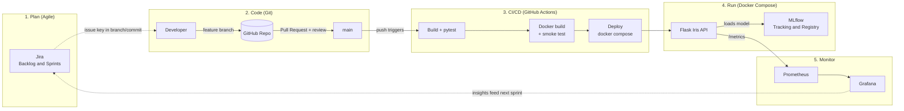

# Agile Assignment No. 2 — DevOps & MLOps Pipeline

**Class:** TE/DS | **Semester:** V | **Subject:** Agile | **Academic Year:** 2026-27
**Project:** Iris Classifier — an ML model served over HTTP, built, tested, containerised, deployed and monitored through one pipeline.

> Fill in your name/roll number above and paste screenshots where marked **📸**.

---

## 0. Project overview

| Component | Tool | Purpose |
|---|---|---|
| Planning | Jira (Scrum) | Backlog, sprints, progress tracking |
| Version control | Git + GitHub | Branching, PRs, history |
| CI/CD | GitHub Actions | Build, test, Docker build, deploy |
| Containers | Docker, Docker Compose | Package and run all services |
| ML lifecycle | MLflow | Experiments, params, metrics, model registry |
| Monitoring | Prometheus + Grafana | Metrics scraping and dashboards |

```
devops-ml-pipeline/
├── app/main.py            Flask API: /predict /health /metrics
├── app/train.py           Trains model, logs to MLflow, registers versions
├── tests/test_app.py      pytest unit tests (run in CI)
├── Dockerfile
├── docker-compose.yml     app + mlflow + prometheus + grafana
├── monitoring/            prometheus.yml + Grafana provisioning + dashboard
├── scripts/load_traffic.sh
└── .github/workflows/ci-cd.yml
```

### How to run everything locally

```bash
docker compose up -d --build         # starts app, mlflow, prometheus, grafana
docker compose ps                    # all 4 services should be Up
```

| Service | URL |
|---|---|
| App | http://localhost:5000 |
| MLflow UI | http://localhost:5001 |
| Prometheus | http://localhost:9090 |
| Grafana | http://localhost:3000 (admin / admin) |

---

## Q1. CI/CD pipeline with GitHub Actions + Docker + Docker Compose [LO4, L3]

### Pipeline (`.github/workflows/ci-cd.yml`)

| Job | Trigger | What it does |
|---|---|---|
| `build-test` | every push / PR | Install dependencies, run `pytest` (health, prediction, bad input, metrics) |
| `docker` | after tests pass | `docker build`, start the container, smoke-test `/health` and `/predict` |
| `deploy` | push to `main` only | `docker compose up -d --build`, verify app, Prometheus and Grafana are healthy |

### Containerisation
`Dockerfile` uses `python:3.11-slim`, installs requirements, trains a fallback model at build time, runs the API under gunicorn and defines a `HEALTHCHECK`.

### Deployment
`docker-compose.yml` defines four services on one network. The app finds MLflow at `http://mlflow:5000` by service name.

### Steps to produce evidence
1. Create a GitHub repo and push: `git init && git add . && git commit -m "Initial pipeline" && git branch -M main && git remote add origin <url> && git push -u origin main`
2. Open the **Actions** tab and open the run.
3. 📸 Screenshot: workflow run with all three jobs green.
4. 📸 Screenshot: `build-test` log showing the pytest results.
5. 📸 Screenshot: `docker` job log showing the smoke-test JSON response.
6. Locally run `docker compose up -d --build` then `docker compose ps`.
7. 📸 Screenshot: `docker compose ps` with all services Up.
8. 📸 Screenshot: `curl -X POST localhost:5000/predict -H 'Content-Type: application/json' -d '{"features":[5.1,3.5,1.4,0.2]}'` returning `{"prediction":"setosa"}`.

---

## Q2. ML lifecycle with MLflow + monitoring [LO5, L3]

### Experiment tracking
`app/train.py` trains a RandomForest on Iris and logs, per run:
- **Parameters:** `n_estimators`, `max_depth`
- **Metrics:** `accuracy`, `f1_macro`
- **Artifact:** the model itself
- With `--register`, the model is added to the registry as a new version of `iris-classifier`.

Run several experiments against the MLflow container:

```bash
pip install -r requirements.txt
export MLFLOW_TRACKING_URI=http://localhost:5001
python app/train.py --n-estimators 10  --max-depth 2 --register
python app/train.py --n-estimators 50  --max-depth 3 --register
python app/train.py --n-estimators 200 --max-depth 8 --register
```

### Model versioning
Open http://localhost:5001 → **Models → iris-classifier**: three versions appear. Optionally assign the alias/stage of your best run.

### Deployment of the trained model
The API loads `models:/iris-classifier/latest` from the registry at start-up (see `load_model()` in `main.py`). After registering a new version:

```bash
docker compose restart app
curl localhost:5000/        # shows model_source: mlflow:models:/iris-classifier/latest
```

### Monitoring with Prometheus and Grafana
The app exposes `/metrics` with:

| Metric | Type | Meaning |
|---|---|---|
| `app_requests_total{endpoint,status}` | Counter | Requests, split by HTTP status |
| `app_request_latency_seconds` | Histogram | Prediction latency |
| `app_predictions_total{label}` | Counter | Predictions per class |

Prometheus scrapes the app every 5 s (`monitoring/prometheus.yml`). Grafana is auto-provisioned with the Prometheus datasource and a dashboard **Iris App Monitoring** (request rate, p95 latency, predictions by class, app-up status).

Generate traffic: `bash scripts/load_traffic.sh`

### Evidence to capture
- 📸 MLflow experiments page listing the runs with params and metrics side by side
- 📸 One run's detail page (parameters, metrics, artifacts)
- 📸 Model registry showing multiple versions of `iris-classifier`
- 📸 `curl localhost:5000/` showing the model loaded from MLflow
- 📸 Prometheus → Status → Targets: `iris-app` is **UP**
- 📸 Prometheus graph of `app_requests_total`
- 📸 Grafana dashboard with live panels after running the load script

---

## Q3. End-to-end DevOps pipeline [LO6, L6]

### Architecture diagram



### Workflow, stage by stage

**1. Agile planning (Jira, Scrum)**
- Create a Scrum project `IRIS`, with epics: *ML Model*, *API*, *CI/CD*, *Monitoring*.
- Example backlog for a 2-week sprint:

| Key | Story | Points |
|---|---|---|
| IRIS-1 | As a user I can get a prediction from a REST API | 5 |
| IRIS-2 | As a data scientist I can track experiments in MLflow | 3 |
| IRIS-3 | As a developer, every push is built and tested automatically | 3 |
| IRIS-4 | As a developer I can deploy all services with one command | 3 |
| IRIS-5 | As an operator I can see request rate and latency on a dashboard | 5 |

- Run sprint planning, move cards across To Do → In Progress → Done, and show the burndown chart at the end.
- 📸 Backlog, 📸 active sprint board, 📸 burndown/sprint report.

**2. Version control (Git)**
- Branching model: `main` (deployable), `develop` (integration), `feature/IRIS-n-short-name` (one per story).
- Commit messages begin with the Jira key (`IRIS-3: add GitHub Actions workflow`) so Jira links commits to issues.
- Work flows feature → Pull Request → review → merge, which triggers CI.
- 📸 Branch graph (`git log --oneline --graph --all`), 📸 a merged Pull Request.

**3. Automated CI/CD** — as described in Q1. Pull requests run build and test only; merges to `main` also deploy.

**4. Deployment** — Docker Compose runs the API, MLflow, Prometheus and Grafana together.

**5. Monitoring and feedback** — Grafana dashboards and Prometheus metrics show behaviour under load. Findings (for example high latency or a surge of 400s) become new Jira backlog items, which closes the loop.

### Execution evidence checklist for Q3
- [ ] Jira board/backlog/burndown
- [ ] Git branch graph and merged PR
- [ ] Green Actions run (all jobs)
- [ ] `docker compose ps`
- [ ] Working `/predict` call
- [ ] MLflow UI with model versions
- [ ] Grafana dashboard under load

---

## Conclusion
The project demonstrates a complete DevOps loop for an ML service: Agile planning in Jira, collaborative Git workflow, automated testing and container builds with GitHub Actions, reproducible deployment with Docker Compose, experiment and model lifecycle management with MLflow, and observability with Prometheus and Grafana.
